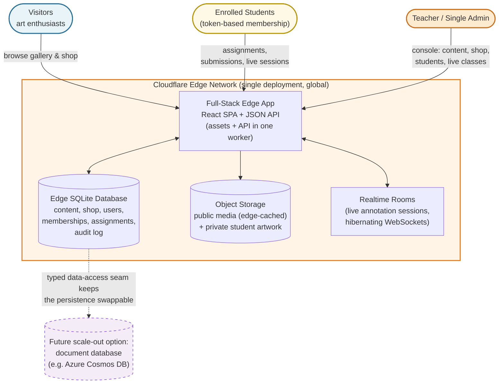

# AliArts — A Unified Art Commerce & Interactive Learning Platform

**A single-edge-deployment platform that runs an artist's entire professional life: a public gallery and studio shop selling original artwork, a structured e-learning academy with live classroom sessions, and a private student workspace where the teacher marks artwork live, stroke by stroke, over the student's shoulder — digitally.**

aliarts.work (live at **aliarts.work**) combines two businesses in one codebase: an **art portfolio and store** for collectors and enthusiasts, and a **membership-based digital art academy** where enrolled students receive assignments, submit artwork, and get real-time, one-on-one visual feedback. Everything — storefront, curriculum, live sessions, submissions, and annotations — is served from a single globally distributed edge deployment.

---

## Target Audience & Business Value

| Audience | What they get |
| --- | --- |
| **Art enthusiasts & collectors** | A curated studio shop of original paintings, drawings, sketchbooks, and souvenirs — browsable by category, with medium, dimensions, and pricing, and clear available/sold status. |
| **Art students** | Structured classical training online: reference libraries, guided lessons, timed classroom-style live sessions, personal assignments, and direct teacher annotation on their own submitted artwork. |
| **The artist / sole educator** | One admin console running the whole business: content, shop inventory, student enrollment, membership lifecycle, assignments, feedback sessions, media library, site settings, and a full audit trail. |

**Business value:**

- **Two revenue streams, one platform.** Original-artwork sales and membership-based instruction share the same deployment, the same media pipeline, and the same admin surface — no fragmented tooling.
- **Live, high-touch teaching that scales.** The teacher annotates over a student's artwork in real time while the student watches; sessions persist independently so feedback is never lost and the original artwork is never altered.
- **Controlled access by design.** Enrollment is token-based: single-use, admin-issued, time-boxed memberships — with sign-in possible via the enrollment token alone, lowering the barrier for non-technical students while keeping the admin surface strictly separate.
- **Fast everywhere, cheap to run.** A single edge worker with an edge-hosted database and object storage: no origin servers to patch, no regions to provision, near-zero cold-start latency for visitors worldwide.
- **Trust and governance.** Every mutation writes an audit-log entry; every destructive admin action requires confirmation with a scope preview; reference imagery carries full source and license attribution.

---

## Key Features

### Art portfolio & studio store (public)

- **Studio shop** — original artworks for sale across curated categories (paintings, drawings, sketchbooks, souvenirs) with medium, dimensions, pricing in multiple currencies, and available/sold/hidden lifecycle managed from the admin console.
- **Reference galleries** — two classical study tracks (figurative and still life) with 14 focused subcategories, search, tag and featured filters, pagination, related imagery, and full source/license/attribution on every image (museum open-access and public-domain collections).
- **Guided lessons** — structured markdown instructions with difficulty and duration, linked to reference imagery.
- **Video channel** — a short-form video page synced from the artist's public video channel, cached at the edge for fast loading.
- **Editable site content** — admin-editable about/contact blocks rendered from structured data, no redeploy needed.

### Interactive assignment playground (private, students)

- **Token enrollment** — single-use, admin-issued enrollment tokens with validity windows that only start counting at redemption; students can even sign in with just their token — no email or password required.
- **Assignment workflow** — classwork and homework with instructions, reference images, attached instruction documents, optional linked lessons, and due dates; reusable templates support one-click reassignment.
- **Submissions** — artwork uploads compressed client-side below 1 MB (with modern format conversion when needed), native support for Apple HEIC/HEIF photos, revision history that never overwrites teacher feedback.
- **Live annotation playground** — the teacher draws over the student's submitted artwork in real time (pencil, brush, eraser, colors, stroke widths, text, line/arrow/rectangle/ellipse, undo/redo, pan/zoom) while the student watches live; annotations persist separately from the original image, and freeform live sessions are supported outside graded assignments.
- **Student dashboard** — membership status and expiry, progress stats, upcoming tasks, uploaded works, and teacher markings in one place.
- **In-app notifications** — a notification center keeps students informed of assignments, feedback, and deadlines.

### Live classes

- **Timed, classroom-style slideshows** — countdown to start, auto-advancing timed images with progress bar, next-image preview, and completion screen, replicating the classical life-drawing classroom online.
- **Instructor console** — force start, pause, resume, next/previous, restart, and force end, with live session monitoring from the admin dashboard.
- **Anchor-based live state** — session positions are computed lazily from persisted anchors, so live state stays correct across clients with no background scheduler.

### Single-admin ecosystem

- **One person runs everything** from a single admin console: dashboard, enrollment token management (single or batch generation, inventory/in-use/expired/revoked views, inspection, revocation), student membership management (extend, revoke, confirmed data deletion with scope preview), assignment review, user administration with self-protection guards, image management with enforced license fields, taxonomy editing, lesson authoring, slideshow scheduling, a full media library, and site settings.
- **Governance built in** — role-based access control, session revocation, per-IP rate limiting on all authentication endpoints, and an audit log entry for every mutation.

---

## High-Level Architecture

**Reading the diagram:** one edge deployment serves the storefront, the academy, and the admin console. Application data lives in an edge-hosted SQLite database for fast, consistent reads close to every user; media — public and private — lives in object storage with edge caching; live annotation sessions run in isolated realtime rooms with their own durable state, mirrored back to the database so nothing is lost. The data layer sits behind typed application interfaces, which is the architectural seam that keeps the persistence swappable: graduating to a document database such as Azure Cosmos DB at higher scale would be a storage-layer change, not an application rewrite.

---

## Tech Stack

| Layer | Technology |
| --- | --- |
| **Frontend** | React 19 + Vite SPA, React Router, Tailwind CSS v4, TypeScript strict mode — served as static assets directly from the edge |
| **Backend** | Hono 4 (TypeScript) JSON API and static-asset host, running as a single Cloudflare Worker |
| **Realtime** | Durable Objects with hibernating WebSockets — one isolated room per live session, durable state that survives hibernation, snapshots mirrored to the database |
| **Database** | Cloudflare D1 (SQLite at the edge) — a compact, fully typed relational model with versioned, reviewable SQL migrations; data access isolated behind typed interfaces, keeping the storage engine swappable |
| **Object storage** | S3-compatible edge storage — immutable public media with edge caching; private student artwork served only through authorized, membership-checked endpoints |
| **Cloud provider** | Cloudflare (compute, database, storage, delivery) with a defined scale-out path to Azure Cosmos DB for document-database workloads |
| **Auth & security** | Web Crypto password hashing, HttpOnly cookie sessions, role-based access control, per-IP rate limiting, single-use enrollment tokens, audit logging on every mutation |
| **Quality & delivery** | Automated CI: typecheck → real-SQL test suite (180+ tests against an in-memory SQLite engine) → build → database migrations → deploy on every push to main |

---

## Links

- **Live Website:** [aliarts.work](https://aliarts.work)
- **Demo Video:** [Demo Video Link]
- **Screenshots:** [Screenshots]

---

## Related Portfolio Projects

- [Muktibeg Flashcard Ecosystem](https://github.com/AliRezaBmeDu/flashcard-ecosystem-architecture) — cross-platform flashcard learning products for Bangladeshi students
- [Muktibeg Campus — EdTech SaaS](https://github.com/AliRezaBmeDu/showcase-muktibeg-campus-saas) — multi-tenant institution management platform
- [Muktibeg Community](https://github.com/AliRezaBmeDu/muktibeg-community-scalable-architecture) — scalable, edge-accelerated learning community
- [TunaTools — Privacy-First Web Tools](https://github.com/AliRezaBmeDu/tunatools-privacy-first-web-tools) — 119 browser-based utilities with 100% client-side processing

---

> This repository is a client-facing showcase of the AliArts platform architecture. It documents the platform's design, engineering decisions, and capabilities; the source code remains private.
